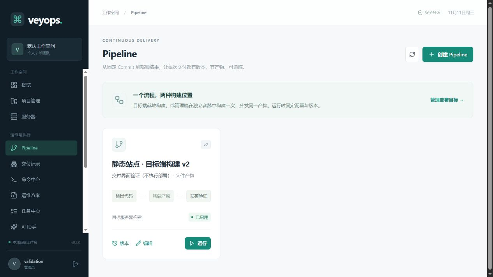

# v0.2 Pipeline、构建部署与 AI 验证

日期：2026-11-11，Asia/Shanghai。

## 实现范围

Pipeline 不可变版本、固定 Commit、统一任务队列、逐目标/步骤状态；部署目标与服务环境配置；目标端/隔离管理端构建；文件/SFTP发布、Registry与Digest、Compose部署；产物和交付历史；可选 OpenAI 兼容 AI、三模式、业务工具、草稿与提案确认。UI 含 Pipeline 表单、步骤排序、版本、运行预览、产物/部署/Registry、AI配置/聊天/提案。

## 真实构建部署

使用独立的静态页面示例，固定 Git Commit，不引用业务仓库或服务目录。测试平台、Git HTTP 服务和 Registry 均为临时实例；构建使用已缓存的 `node:22`，未修改 Docker daemon 配置。

原始任务、产物与交付状态记录保留在本地，包括首次失败与修复后成功记录。

| 组合                   | 目标          | 结果                                        |
| ---------------------- | ------------- | ------------------------------------------- |
| TARGET / FILE          | 验证主机 A、B | 两台均成功并通过健康检查                    |
| MANAGER / FILE         | 验证主机 A、B | 构建一次、SFTP 分发，两台均通过健康检查     |
| TARGET / DOCKER_IMAGE  | 验证主机 B    | 构建、推送、按 Digest 执行 Compose 成功     |
| MANAGER / DOCKER_IMAGE | 验证主机 B    | 隔离构建、推送、按 Digest 执行 Compose 成功 |

两台管理端文件部署引用同一产物，并通过 SHA256 校验。目标端各自产物均记录 SHA256，校验后切换独立目录下的 `current`。两条 Docker 路径记录了不可变 Digest，最终示例容器的 Docker Health 状态为 healthy。Docker 任务未配置额外健康检查命令，因此交付记录的 `health_status` 为 `NOT_CHECKED`。

首次测试发现了自建 Git dumb HTTP 不支持浅fetch、目标用户全局代理干扰；已修复为隔离全局Git配置、完整检出并核验Commit，随后四种路径均成功。失败记录保留，没有篡改为成功。

## 临时网络问题与清理

Docker Compose 自动创建的临时网络与开发机所在网段重叠，导致开发机到验证主机 B 暂时不可达。通过验证主机 A 的 SSH 跳板读取路由、Compose 标签和任务数据库，确认主机在线、四条任务均已成功。

核对归属后，仅删除本轮测试容器与该临时网络。开发机的 ping 和 SSH 随后恢复，路由重新经原网关。没有停止已有业务容器、服务或 Docker daemon。示例 Compose 使用 `network_mode: none`，避免无外部访问需求的示例创建网络。

本轮临时 Registry、Git HTTP 服务和 API 实例均已停止，验证凭据已禁用、会话已撤销。验证记录与发布样例保留在独立的临时目录内。

## 真实 AI 验证

- 按用户指定的 DeepSeek Base URL 和 `deepseek-flash` 发出请求，HTTP200并返回文本。
- 通过应用API真实执行 `list_projects` 工具，返回隔离测试项目数量；没有命令或部署副作用。
- 生成 `uname -srm` 待确认提案，创建提案时没有提交任务；确认后提交任务并执行成功。
- 浏览器通过AI页面生成只读巡检方案草稿，未查询服务器、未执行。系统设置显示模型与已配置状态，编辑表单Key为空，不回显。
- 真实 Key 仅经内存传递和 AES-256-GCM 存储，未进入源码、报告或明文配置。

## 自动化与界面

最终 `npm test` **53/53通过**，`npm run lint` 与 `npm run build` 通过，锁文件 `npm ci --ignore-scripts --dry-run` 检查通过。自动化覆盖数据库/API/RBAC、SFTP真实协议传输、进程参数隔离与脱敏、四种构建矩阵、版本与Commit快照、租约恢复同步历史、可选AI、权限/范围/全局禁止、提案并发消费与配置漂移、会话隔离及加密初始化。私有Git helper另外用本机真实Git的fill/approve/reject协议测试；Compose特殊字符序列化另外经官方compose-go dotenv解析器独立往返校验。

界面实测了Pipeline编辑产生v2且v1保留、版本列表、AI草稿与可选配置、密钥不回显。截图中的本地项目明确标记“界面验证（不执行部署）”；真实部署结果来自上表的独立Linux验证实例，未伪造成功记录。

## 仍有限制

尚未实测生产Registry鉴权、私有Git Token仓库和真实PostgreSQL；当前不支持SSH Git、Submodule、自动回滚或读取仓库源码的AI分析。管理端Docker daemon可用性、共享目录映射和网络IPAM由部署者配置。平台自身的Docker Compose定义仍未在当前Windows环境实构建；本轮真实验证的是Linux上的API/Worker与隔离构建容器。完整V1.0仍有后续任务。
