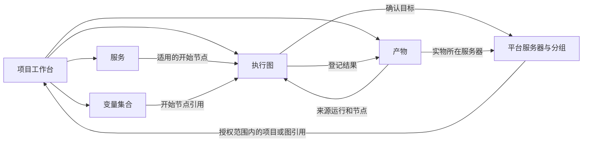

# 项目资源、工作台和变量集合契约

本契约用于阶段 0 定稿，供后续数据库、API 和 Web 实现共用。对象 ID 在真实数据中使用 UUID，演示定义中的短名用于加载时解析引用。全局服务器和分组、项目服务、变量集合及执行图分别维护身份和权限。 [重构实施计划](项目交付重构实施计划.md)

## 六类对象与导航

项目默认打开「项目资源」，其中维护仓库、服务和变量集合。「执行图」承载编辑、开始节点运行和执行历史。「产物」承载登记结果、实物验证和清理。「项目配置」承载基本信息、执行默认值、项目公共变量和 AI 策略。四个入口共享项目标题与返回项目视图的 `view`。平台「服务器」承载 SSH、凭据、状态、监控与分组管理。

| 对象 | 规范地址 | 定位和可见性 |
| --- | --- | --- |
| 项目 | `#/projects/:projectId` | 入口保留已授权的 `view`。项目配置使用 `#/projects/:projectId/configuration`。 |
| 服务 | `#/projects/:projectId?resource=services&serviceId=:serviceId` | 卡片标题打开同一服务详情。服务及地址使用项目读取权限。 |
| 变量集合 | `#/projects/:projectId?resource=environment-sets&environmentSetId=:environmentSetId` | 显示本项目集合元数据与脱敏的变量项。 |
| 执行图 | `#/projects/:projectId/execution-graph` | 使用 `version`、`flow`、`start`、`node`、`field` 或 `run` 定位。服务卡片打开开始节点时携带 `start` 和 `serviceId`，项目视图以 `view` 返回。 |
| 产物 | `#/projects/:projectId/artifacts` | 使用 `artifactId` 定位记录，`serviceId`、`environmentSetId`、`repositoryId`、`ref`、`commitSha`、`serverId`、`kind` 和 `status` 分别筛选。详情关联生产运行及节点。 |
| 平台服务器与分组 | `#/servers?serverId=:serverId`、`#/servers?groupId=:groupId` | 目标选择、预览和产物详情均跳到相同的全局实体。返回链接通过已解析的内部对象和视图生成。 |

服务卡片传入的 `serviceId` 仅在图声明可接收且当前用户获授权时生成 `SERVICE` 参数初值 `{serviceId}`。URL 中的 `environmentSetId` 用于选择或回看集合，固定集合与目标始终由图定义解析。运行表单只按已发布开始节点提交参数，服务、集合、构建目标、发布目标和产物分别使用声明的字段 ID。服务详情、预览、产物和服务器之间保留可读的 `view` 与来源对象 ID。缺失或已归档的可编辑对象给出空态，历史页面用对应的快照显示原对象。

## 服务与访问地址

| 记录 | 字段与约束 |
| --- | --- |
| `Service` | `id`、`projectId`、`name`、`slug`、`serviceType`、`description`、`revision`、`archivedAt`。`(projectId, slug)` 唯一，服务归属在项目内校验。仓库关联按服务管理，主仓库用于导航与预填。 |
| `ServiceAddress` | `id`、`serviceId`、`name`、`url`、`position`。`serviceId` 为必填外键，服务内的 `position` 唯一。DTO 的 `addresses` 按 `position` 排列，每行返回 `{id,name,url}`。 |

API 路径以 `/api/v1` 为前缀。`GET /projects/:projectId/services` 返回带有序地址的服务列表。`GET /projects/:projectId/services/:serviceId` 供详情、表单载入和冲突后的读取。`POST /projects/:projectId/services` 一次创建服务及地址，`PATCH /projects/:projectId/services/:serviceId` 接收服务字段、可选 `addresses` 与必填 `expectedRevision`。创建从修订 `1` 开始。每次成功编辑递增一次修订并返回新的服务视图。

- 新地址省略 `id`，由服务端分配。原地址通过已有 `id` 更新名称和链接。请求中已给出的 ID 均须属于此服务且只出现一次。
- 省略 `addresses` 时保留地址，`addresses: []` 清空地址，非空列表作为完整的新顺序。旧列表中缺席的 ID 视为删除。服务端按数组顺序写回位置。
- 名称与 URL 均必填，允许去除外层空白。链接只接受含有效主机的绝对 HTTP(S) URL，保留路径、查询参数和片段。输入内嵌用户名或密码时返回对应行错误。
- 服务端在同一事务核对项目归属、归档状态和修订，保存服务及地址增删改、顺序和审计。两个编辑者提交同一修订时最多一次成功。`DELETE` 归档服务前检查发布版本和在途引用，历史查询使用原 ID 与快照。
- 服务表单以地址 ID 或仅供页面使用的临时行键维护草稿。校验失败定位到错误行，修订冲突时保留草稿并允许读取当前版本。卡片按服务内顺序展示地址，名称在新标签打开，复制按钮只复制该行完整 URL 并显示反馈。卡片统一展开 URL 后可选择和折行，复制失败时仍可手动复制。空列表显示「暂无访问地址」，具有编辑权限时提供编辑入口。键盘可操作各控件。

## 变量集合与开始节点

`EnvironmentSet` 保存 `id`、`projectId`、`name`、`description`、`revision`、`archivedAt`。集合项以 `(environmentSetId, key)` 唯一，保存说明、敏感标记和来源。普通值存文本，敏感值存加密记录或获授权的凭据引用。`EnvironmentSet` 的用途是向运行提供值，Git 版本、仓库文件、目标、发布方式和审批由各自的图字段决定。

`GET/POST /projects/:projectId/environment-sets` 列出或创建集合。`GET/PATCH/DELETE /projects/:projectId/environment-sets/:environmentSetId` 读取、保存或归档。`PATCH` 要求 `expectedRevision`，修订、元数据、变量项和审计同事务提交。省略 `variables` 保留变量，空列表清空。初始修订为 `1`，每次成功编辑递增一次。

| 变量写入 | 定义 |
| --- | --- |
| 普通值 | `{key, value, description?, isSecret?: false}`。空字符串作为有效值保存。 |
| 新敏感值 | `{key, isSecret: true, value, description?}`。服务端加密后存储。 |
| 凭据引用 | `{key, isSecret: true, credentialId, description?}`。保存时核对凭据类型与引用权限。 |
| 保留敏感值 | `{key, isSecret: true, keepSecret: true, description?}`。保留已存在的同键敏感项。脱敏文本中的掩码由表单转换为此模式。 |

每个敏感项只接受一种写入模式。集合读取返回键、说明、敏感状态和脱敏信息，普通项另有 `value`。敏感值的明文读取使用单独的授权操作并记审计。变量名区分大小写，表格与 dotenv 共用草稿并保留已有键的说明。文本以 `# @secret KEY` 标记紧随其后的同键赋值，重复键、孤立标记、保留键和语法错误定位到对应行。表格、文本导出、冲突响应、运行历史与日志默认脱敏。

| 开始节点 `environmentSet` | 解析规则 |
| --- | --- |
| `{mode:'NONE'}` | 省略集合，运行可使用项目公共变量和节点显式来源。 |
| `{mode:'FIXED', environmentSetId}` | 使用图声明的本项目集合。 |
| `{mode:'INPUT', fieldId}` | 通过开始节点声明的单值 `ENVIRONMENT_SET` 参数读取。字段定义决定必填性、默认值和允许集合。表单和触发规则复用该字段定义。 |

每次运行最多解析一组集合。预览的 `environmentSet` 为 `null` 或 `{id,name,revision}`，键级预览附生效来源及敏感标记。计划内部保存该次普通值及加密值或凭据的安全引用，历史产物可用 `environmentSetId` 与修订追溯。确认前集合修订或授权发生变化时，返回差异并重新预览。已确认的运行沿用冻结的集合修订，执行器在消费节点复核凭据当前可用性及授权。归档集合从新运行选择退出，既有快照和引用受运行状态保护。

「加载变量文件」节点使用固定 Git 工作区中的相对路径或显式映射，映射读取开始参数或集合中的键。节点变量覆盖顺序为仓库文件、项目公共变量、开始集合、节点绑定。上层删除键后读取下层值。预览与派发使用同一解析结果，记录固定 SHA、文件路径、是否必需及各层来源。可选文件未命中时标记跳过，显式必需文件缺失、不可读或越界时定位到消费节点。项目和实际服务标识、已解析的 Git 提交及触发来源等系统保留键由平台注入。

## 全局目标引用与权限

目标字段 `TARGETS` 使用 `serverIds` 和 `groupIds`，可附 `strategy`、`maxParallel` 和 `failurePolicy`。构建节点与部署节点各自绑定固定目标或所声明的开始参数。预览在平台资源范围内解析、按实际服务器 ID 去重并显示来源，确认后随计划冻结服务器身份和组成员。确认前组成员变化时要求重新预览。历史继续展示确认时的成员。管理端仅构建可省略目标。API 复用 `/servers`、`/servers/:serverId` 和 `/server-groups`，分组补充 `GET /server-groups/:groupId`，平台详情提供授权范围内的反向引用。

平台提供构建位置、工作区根、并发和日志留存默认值，项目配置可覆盖。支持节点设置的字段优先使用节点显式值，再读项目默认和系统默认。SSH 目标在预览和派发阶段检查状态、权限、指纹和凭据。服务访问地址供展示和跳转，部署目的地、方式与启停配置由部署节点声明。

| 角色 | 项目及平台动作 |
| --- | --- |
| 观察者 | 查询获授权的项目、服务地址、变量摘要、图与版本、产物和执行结果。可打开、展开或复制服务地址。 |
| 操作员 | 在项目授权范围内维护服务、地址、变量集合和执行图，预览、发布及运行。目标选择同时受平台资源授权约束。 |
| 管理员 | 管理平台服务器、分组、凭据与系统设置，管理项目 AI 策略，并处理源码审核、图内审批和产物固定或清理。敏感值明文授权单独检查和审计。 |

业务接口沿用 `{data}` 与 `{error:{code,message}}`。`401` 表示会话无效或缺失，`403` 表示对可见对象缺少动作权限，`404` 表示对象缺失或在可见范围外。修订冲突使用 `409` 和 `error.details.currentRevision`，受保护引用沿用 `error.references`。`400` 字段错误的 `error.details.fieldErrors` 每项包含 `path`、`code`、`message`。`path` 使用字段名和零基数组索引。例如第二行地址的 URL 对应 `['addresses', 1, 'url']`，变量编辑器采用同样约定。图和运行问题沿用包含流、节点、字段、实体与原因的计划诊断。

Web 管理编辑草稿、有序表单、脱敏显示和返回位置。API 校验角色、可见性、实体归属、修订、绑定与有效值来源，并创建计划快照。数据库对 SQLite 和 PostgreSQL 执行同一外键、唯一性与事务约束。Worker 使用冻结的计划并在访问凭据或写入目标前复核权限、身份和可用性。
