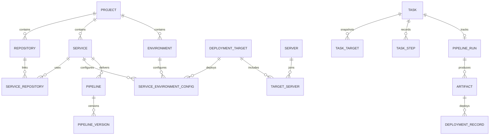

# veyops 需求梳理与实施计划

更新（2026-11-11）：已推进至 v0.2，新增版本化 Pipeline、部署目标与环境配置、四种构建部署组合、SFTP/Registry/Compose、可选 OpenAI 兼容 AI 和受控工具/提案。实际验证与剩余限制见 [v0.2 验证报告](v0.2验证报告.md)。下文“首轮”仍指 v0.1 阶段规划，不能据此认为后续能力尚未开发；完整 V1.0 尚未全部完成。

依据：[V1.3 需求规格说明书](../需求文档.md)。该文件仍是 V1.0 产品的开发基线；本文将其拆解为可实施、可验证的工作。原文中的 MS-DevOps 作为产品描述，代码和界面统一使用 `veyops`。

## 一、产品目标和范围

这是面向个人或单团队的轻量 Web 运维平台。以项目组织业务，以服务作为构建和部署单位，以环境隔离运行配置，通过无 Agent 的 SSH 管理服务器。项目管理、命令中心、AI 助手是三个主要入口，统一任务引擎是执行基础。

| 业务域     | V1.0 需要解决的问题          | 核心能力                                                                 |
| ---------- | ---------------------------- | ------------------------------------------------------------------------ |
| 身份和凭据 | 谁可以操作、如何安全认证资源 | 登录会话、ADMIN/OPERATOR/VIEWER、加密凭据、引用检查                      |
| 服务器资源 | 多台主机如何统一管理         | SSH 密码/私钥、指纹确认、连接检测、分组、标签                            |
| 项目组织   | 代码与运行环境如何对应       | 多仓库、多服务、Monorepo、多环境、部署目标、变量、地址、依赖             |
| 日常运维   | 如何可靠地批量执行操作       | 临时命令、模板、版本化多步骤方案、目标预览、并发/顺序、超时、取消        |
| 应用交付   | 如何从固定代码版本部署服务   | 版本化 Pipeline、构建、产物、文件/Compose 部署、健康检查、逐服务器记录   |
| AI 助手    | 如何在可控权限下辅助工作     | OpenAI-compatible Provider、Tool Calling、分析与草稿、提案确认、三种模式 |
| 可追踪性   | 如何查看结果、排查与恢复     | 统一任务中心、文件日志/SSE、审计、聚合视图、备份恢复                     |

不纳入 V1.0：Kubernetes、Swarm、集群调度、自动扩缩容、多租户、分布式 Agent、完整监控系统和交互式 Web PTY。部署回滚、Webhook、定时运维和通知按原文归入后续版本。

## 二、关键业务模型

1. 凭据、服务器、分组、部署目标、任务和运维方案是全局资源。仓库、服务、环境属于项目。
2. 服务与仓库是多对多关系，仓库关联保存子目录，支持 Monorepo。
3. 一个服务在一个环境中只有一份有效部署配置；配置关联可复用的部署目标，目标成员保存服务器执行顺序。
4. 环境级变量与服务环境级变量分层合并，服务级覆盖环境级。敏感变量只保存凭据引用，不能同时保存明文值。
5. Pipeline 和运维方案修改时追加版本；运行任务绑定启动时的版本、配置和目标快照。
6. 每台服务器独立保存执行和部署结果。项目和服务器采用软删除；历史任务、产物和部署记录不能级联删除。
7. 项目依赖需要在业务服务中进行有向图环检测；数据库中的自引用禁止检查只能阻止直接依赖自身。

### 构建与部署的三个独立维度

| 构建位置       | 产物类型     | 部署方式       | 执行要求                                     |
| -------------- | ------------ | -------------- | -------------------------------------------- |
| TARGET（默认） | FILE         | FILE           | 各目标主机独立检出、构建、部署               |
| MANAGER        | FILE         | FILE           | 隔离构建一次，以 SFTP 分发同一份产物         |
| TARGET         | DOCKER_IMAGE | DOCKER_COMPOSE | 各目标主机独立构建镜像后部署                 |
| MANAGER        | DOCKER_IMAGE | DOCKER_COMPOSE | 隔离构建、推送 Registry，目标拉取固定 Digest |

不能将“Docker 部署”等同于“管理端构建”。构建记录必须保存实际 Commit；分支名不能替代部署版本。

## 三、执行和安全约束

### 所有执行入口共用同一引擎

命令中心、运维方案、Pipeline 和 AI 业务工具只负责构造受校验的任务。Task Handler Registry 选择处理器，共用队列、目标解析、SSH、取消和日志能力。业务模块不能直接创建另一套后台队列或 SSH 客户端。

- 创建任务前解析目标、去重、检查权限，并展示明确的服务器列表和数量；空选择不能解释为全部服务器。
- 执行参数、目标连接信息和版本在创建时固定；以后修改分组或配置不能改变已排队任务。
- 默认每个父任务最多 3 个目标并发，默认失败策略为继续；顺序执行和失败即停止单独配置。
- 数据库短事务原子领取任务，执行期间不持有事务。租约和心跳用于识别 Worker 中断。
- SQLite 采用单实例、单 Worker；PostgreSQL 为后续多 Worker 提供原子领取基础。
- 取消需要终止 SSH 通道并更新剩余目标；取消请求不等于已经撤销远程产生的副作用。
- 中断且执行结果不确定的写操作进入 `NEEDS_ATTENTION`，不能自动重跑整套脚本。
- 日志保存为文件，数据库仅保存索引和大小；需要输出上限、敏感值脱敏、实时流和历史偏移读取。

状态集合：`PENDING`、`RUNNING`、`SUCCESS`、`FAILED`、`PARTIAL_FAILED`、`TIMED_OUT`、`CANCEL_REQUESTED`、`CANCELLED`、`NEEDS_ATTENTION`。

### 权限与凭据

| 身份/模式          | 允许                   | 限制                                         |
| ------------------ | ---------------------- | -------------------------------------------- |
| ADMIN              | 完整管理               | 仍受 SSH 指纹、执行确认等安全约束            |
| OPERATOR           | 业务资源管理与任务执行 | 不能管理凭据、系统设置和 AI 权限策略         |
| VIEWER             | 只读查询               | 禁止修改与执行                               |
| AI READ_ONLY       | 查询、分析、生成草稿   | 禁止写入和执行变更                           |
| AI CONFIRM（默认） | 生成操作提案           | 用户确认后再校验权限并执行                   |
| AI FULL_CONTROL    | 在明确授权范围内执行   | 不能突破发起用户权限、全局禁止和强制确认规则 |

AI 判定顺序：用户权限 → 全局规则 → 项目或系统模式 → 资源范围 → 操作类别 → 风险 → 确认。规则优先级为 `DENY > REQUIRE_CONFIRM > ALLOW`。混合授权的批量请求整体拒绝；未知风险不能直接放行；确认时检查提案过期、目标和当前权限。

凭据使用 AES-256-GCM 加密，主密钥独立于数据库持久化；API 不返回明文，AI 工具不可读取凭据，任务执行时按需解密。首次 SSH 连接必须由用户确认主机指纹，之后严格比对；不能自动信任未知主机。任意 Shell 无法仅靠字符串黑名单保证安全，必须结合角色、目标范围、操作确认和低权限执行用户。

管理端构建必须在隔离环境执行不可信脚本，不能放在平台进程中，也不能随意向构建容器挂载宿主机 Docker Socket。

## 四、技术架构与数据基线

- TypeScript 严格模式，NestJS 模块化单体，React + TypeScript 管理端。
- Kysely 统一数据访问；SQLite + better-sqlite3 为默认，pg 为 PostgreSQL 连接适配。
- 不强制 Redis，不安装远程 Agent；HTTP API 与 Worker 共享代码、数据库和数据目录。
- 统一 `/api/v1` 路由前缀、DTO 校验、异常格式、会话认证和操作审计。
- UUID 文本主键；UTC Unix 毫秒时间；0/1 整数布尔；JSON 用 TEXT，避免 PostgreSQL 专属业务数据类型。
- SQLite 开启 WAL、外键、busy_timeout；PostgreSQL BIGINT 由连接层统一转换为安全范围内的 JavaScript number。
- 数据库更换是迁移操作，不能在运行时只切换连接字符串。

初始迁移建立原文定义的 40 张业务表，包含约束和索引。为了固定任务执行连接信息，`task_targets` 增加端口、用户名、凭据引用和指纹快照；`tasks` 增加显示名称，`servers` 增加描述。所有扩展均保留原有核心关系。

表已建立仅代表数据基线，不代表其对应业务功能已实现。Pipeline、AI 等后续模块可以使用这些表持续开发。

## 五、交付阶段与依赖

本轮为首个可运行增量，目标是建立真实持久化和核心操作闭环。完整 V1.0 仍需要后续迭代，不能把首轮骨架或预留页面当作正式版交付。

| 阶段          | 原文任务     | 交付内容                                              | 验收出口                                 |
| ------------- | ------------ | ----------------------------------------------------- | ---------------------------------------- |
| M0 项目初始化 | DEV-001～002 | 工作区、严格 TS、前后端启动、统一返回/错误/DTO        | 前后端独立启动，生产构建通过             |
| M1 数据与身份 | DEV-003～007 | 双 Dialect、版本迁移、目录与配置、会话/RBAC、审计基础 | 空库初始化、登录鉴权、事务/约束测试      |
| M2 凭据和主机 | DEV-008～010 | AES-GCM、凭据引用、SSH/SFTP、指纹、主机和分组         | 能创建真实主机并显式验证 SSH 连接        |
| M3 统一任务   | DEV-011～014 | 原子领取、租约、心跳、日志、取消、中断处理            | 多目标结果独立，超时/取消/重启不盲目重放 |
| M4 日常运维   | DEV-015～019 | 目标解析、临时命令、命令模板、方案版本与执行          | 选择目标确认后执行，保存固定版本和日志   |
| M5 项目模型   | DEV-020～025 | 项目/仓库/服务/环境、部署目标、变量/地址/依赖         | 能建立完整服务环境部署关系，拒绝循环依赖 |
| M6 构建部署   | DEV-026～031 | Pipeline 版本、步骤处理器、两种构建位置、文件分发     | Node.js 多主机文件部署闭环               |
| M7 容器产物   | DEV-032～035 | Registry、BuildKit、Push/Pull、Compose、产物追踪      | 固定 Digest 的多主机 Compose 部署        |
| M8 AI Agent   | DEV-036～041 | Provider、策略、工具、确认提案、仓库分析、运维助手    | 三种权限模式均通过越权与确认测试         |
| M9 产品完善   | DEV-042～045 | 自定义视图、完整任务 UI、设置、备份与恢复             | 聚合状态与历史可追踪，备份可实际恢复     |
| M10 联调发布  | DEV-046      | 双库、SSH、部署、AI、多服务器集成验证与发布           | 完成原文闭环 A～G 后才标记 V1.0          |

依赖主线：`M0 → M1 → M2 → M3 → M4`；M5 可在数据基线完成后推进，`M5 + M3 → M6 → M7`；AI 工具依赖已验证的业务服务；M9/M10 完成可运维交付。

### 本轮实施边界

本轮优先实现并联调：

1. 本地可运行的前后端工程、数据库连接与初始迁移。
2. 首位管理员初始化、登录/退出、会话认证、角色校验和审计基础。
3. 加密凭据管理、服务器和分组管理、显式 SSH 主机指纹与连接检测。
4. 统一数据库任务队列、目标快照、命令执行、每台服务器结果、日志、超时和取消。
5. 版本化运维方案的基础管理与共享任务入口。
6. 项目、仓库、服务和环境的基础组织能力与真实数据页面。
7. 自动化测试、环境变量示例、运行说明和容器部署基础配置。

这不是 M0～M5 每个子项的完整验收。SFTP 文件交付、完整目标解析、可参数化安装模板、管理端隔离构建、完整 Pipeline、Docker 发布、AI Tool Calling/权限执行、备份恢复和真实多主机验收需按后续清单完成；最终已实现列表以 README 和实际通过的测试为准。

## 六、验收与测试策略

| 类别     | 自动化验证                                         | 需要外部环境的验证                             |
| -------- | -------------------------------------------------- | ---------------------------------------------- |
| 数据     | 40 表迁移、回退、外键、唯一键、事务回滚、变量互斥  | PostgreSQL 实例上的初始化与一致性              |
| 认证     | 初始化竞争、密码错误、会话失效、只读角色拒绝写入   | HTTPS 反向代理与部署 Cookie 行为               |
| 凭据     | 加密完整性、错误密钥、API 不返回明文、引用保护     | 真正 SSH 密码/私钥与 Registry/Git 注入         |
| 任务     | 去重、确认、状态、并发、失败策略、取消、超时、中断 | 单台/五台真实 SSH 主机、连接断开与 Worker 崩溃 |
| 运维方案 | 版本唯一和固定、步骤顺序、参数校验、失败停止       | Docker/Node/Nginx 初始化、重复执行幂等性       |
| 项目部署 | 唯一标识、归属校验、环境配置、循环依赖             | Node/React/Nest 构建、SFTP、隔离构建、Compose  |
| AI       | 策略优先级、范围、提案过期、确认重检、拒绝不执行   | 实际 Provider 的 Tool Calling 与仓库分析       |
| 恢复     | 数据与密钥持久化、迁移可重复运行                   | SQLite WAL 安全备份、pg_dump、完整恢复演练     |

测试替身只能证明调度和策略逻辑；不能替代真实 SSH、PostgreSQL、Docker 和 AI 服务的集成验收。没有真实资源时明确记录验证边界，不生成虚构在线主机或成功部署数据。

## 七、后续开发顺序与交付物

首轮闭环验证后，优先补齐 M2～M5 的缺项，再完成固定 Commit 的目标端文件部署；随后推进隔离管理端构建和 Docker 产物交付，最后接入 AI 工具与确认机制。每次迭代均应更新 API 文档、测试和本文件中的范围。

正式 V1.0 交付仍须包含：源代码、版本化 Migration、两种数据库初始化方案、环境示例、Docker Compose、API 文档、使用说明、AI 工具说明、Docker/Node/Nginx 运维方案模板、自动化测试，以及已演练的备份恢复说明。

原始需求、数据库结构、界面和实际执行行为不一致时，应先修正领域服务与契约，再扩展页面；不能为了演示绕过确认、权限或任务引擎。
