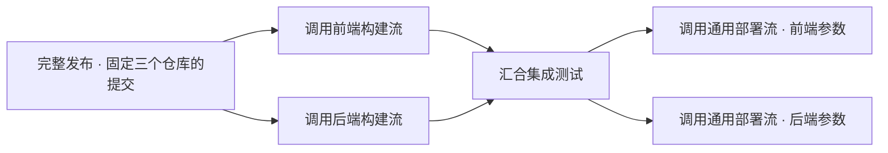

# 项目执行图需求与实施计划

模块需求版本 **V1.1**，规划日期 **2026-11-19**，改造前的实现核对至提交 `6e85b26`。第四节给出分期交付范围，第八节记录已实现的基础闭环及其验证结果。模块版本独立于平台发布编号。[用户提供的需求基线](项目执行图需求基线.md)

执行图仍处于开发阶段。新编排使用全新数据库和数据目录，旧项目、流水线版本、规则和运行记录可弃用。原需求中的旧数据转换与并行切换验收，以第五节的全新初始化和新模型验收为准。

## 一、项目模块将如何使用

**每个项目自动获得一张逻辑执行图。** 用户在项目里编辑和发布这张图，在图内选择一个有名称、输入和输出的**执行流**来运行。服务可以引用多个流，多个服务也可以引用同一流，通过各自的参数映射完成部署。仓库提供代码，服务器和服务器组提供执行目标。只做运维的流也可以独立存在。

例如，一个项目有前端、后端两个服务和一个公共库。项目负责人可以从「完整发布」运行一次端到端流程，也可以从后端服务单独运行「部署已有产物」，选择昨天的镜像 Digest、测试环境和服务器组。

| 项目导航 | 用户可完成的操作 |
| --- | --- |
| 项目概览 | 查看服务、访问链接、最近运行、发布结果和依赖关系。 |
| 代码仓库 | 管理各仓库的地址、凭据和连通状态，自动探测远程默认分支，浏览分支、Tag 和关联流，查看 Git 事件接入状态。 |
| 服务管理 | 管理 Monorepo 子目录、多仓库来源、构建及运行方式、端口、健康检查和访问地址，按用途绑定流并配置参数。 |
| 执行图 | 编辑项目画布，按服务、仓库、流类型、触发器或运行状态筛选。打开流详情查看输入输出、关联资源、触发器、版本、并发策略、权限和历史。 |
| 环境管理 | 管理开发、测试、预发布、生产和自定义环境，配置服务器或组、变量、服务参数、部署路径和环境地址。 |
| 构建产物 | 按项目查找归档、下载、核对摘要，查看生产者和使用记录，选择历史产物发起部署。 |
| 执行记录 | 按流、服务、仓库、环境、状态、触发类型和时间筛选。详情在运行时的图上着色，显示节点耗时、标准输出／错误、SSH 日志、脱敏输入输出、子流、产物和逐台部署结果。 |
| 项目设置 | 配置执行与日志默认值、目标端工作目录、项目 AI 策略及授权。模型连接继续在系统设置管理。 |

仓库页和服务页提供跳转、带上下文运行和参数映射入口。编辑器采用节点面板、画布和页内属性面板，顶部提供保存、发布、版本和运行选定流。支持拖拽连接、复制删除、多选框选、分组折叠、自动布局、平移缩放、撤销重做。筛选和折叠只改变当前视图，保存时保留被隐藏的节点。

## 二、现有能力和改造位置

| 领域 | 已有基础 | 本次需要改变的地方 |
| --- | --- | --- |
| 项目及服务 | 项目已有多仓库、多服务、环境、服务与仓库多对多关系、项目卡片和聚合交付记录。[数据模型](../apps/api/src/core/database/schema.ts) · [项目交付页](../apps/web/src/pages/ProjectDelivery.tsx) | 新增唯一执行图，服务通过多对多绑定引用流；项目级集成构建、巡检可省略服务。保留地址、依赖、项目默认值及归档查看入口。 |
| 编排与执行 | 现有 Pipeline 固定一个服务；节点数组按顺序执行，界面按相邻顺序连线。支持多仓库固定 SHA、环境节点和分步日志。[节点校验](../apps/api/src/modules/pipelines/pipeline-node-config.ts) · [构建执行](../apps/api/src/modules/builds/builds.service.ts) · [当前节点图](../apps/web/src/pages/PipelineNodeGraph.tsx) | 新增端口和显式边、项目图版本、子图提取、流调用与 DAG 调度。把现有检出、SSH、构建和发布能力接成节点处理器。 |
| 队列与发布 | Task 已有队列、租约、心跳、取消和日志。历史产物部署会核对原 Pipeline，目标端产物还会核对原服务器。[Worker](../apps/api/src/modules/tasks/task-worker.service.ts) · [流水线服务](../apps/api/src/modules/pipelines/pipelines.service.ts) · [交付规则](PIPELINES.md) | FlowRun 记录一次业务运行，NodeRun 记录节点及尝试，实际工作继续交给现有 Worker。已归档并验证可移植的制品可映射给其他服务；仅在原主机可用的制品仍限制到原主机，或先显式导出并验证。 |
| 触发与 AI | 已有 Gitea 签名推送、定时、轮询、绑定版本预览；流水线编辑器可分析仓库，预览并采用 AI 草稿。[触发服务](../apps/api/src/modules/pipeline-triggers/pipeline-triggers.service.ts) · [AI 草稿](../apps/web/src/pages/PipelineAiDraft.tsx) · [AI 权限](AI工具与权限.md) | 触发绑定改为流。先保留既有规则及草稿入口，再扩展 PR、Tag、通用事件和整图 AI。 |

## 三、必须先定下来的执行契约

| 对象 | 约束与可观察结果 |
| --- | --- |
| ExecutionGraph、GraphVersion | 数据库按项目唯一约束建图；新项目事务建图，存量项目幂等补建。保存更新草稿，发布生成包含全部流、节点、边、端口和调用关系的完整不可变快照。同一草稿被两人编辑时，用修订号检测覆盖冲突。恢复历史以所选快照生成新草稿，确认后另行发布。 |
| ExecutionFlow、GraphNode、GraphEdge | 流有稳定 ID；`GraphVersion + Flow ID` 唯一确定可执行定义。一个节点在同一版本中只归属一个流。入口和出口可有多个端口；每个端口声明类型、必填性及来源。发布时校验连通性、端口映射、必填输入、资源归属、节点依赖环和跨流调用环。 |
| ServiceFlowBinding | 绑定记录服务、用途、流、版本策略和输入映射，例如将后端服务的端口、环境变量、服务器组及指定 Artifact 传给通用部署流。可跟随最新发布或固定发布版本。预览后始终固定本次实际版本；生产默认沿用已确认绑定。 |
| SourceSnapshot | 预览解析全部代码来源，以仓库、来源节点、目录和引用记录分支或 Tag、完整 SHA 及实际检出 SHA。父子流共用本次发布的来源快照，按 SHA 浅检出。预览到启动之间来源发生变化时重新确认；运行途中分支前移，已启动任务继续使用原 SHA。 |
| Artifact、Deployment | 产物独立保存项目、适用服务、类型、版本、存储位置、Checksum 或镜像 Digest、源提交及生产它的图版本、流和运行。支持上游传递、历史选择和外部制品引用。部署流声明 Artifact 输入，校验项目、服务适用范围、类型、完整性及目标平台。文件归档、二进制、静态资源和自定义文件可共用文件存储；镜像按 Digest 发布，生产拒绝仅提供 `latest` 的引用。逐目标保留部署、健康检查与回滚结果。 |
| FlowRun、NodeRun | 每次手动、自动或子流启动都创建独立 FlowRun，保存项目、图版本、流、触发来源、父运行、输入输出、源码快照、起止时间和错误。NodeRun 记录节点、分支或目标、尝试次数、状态与日志索引。按需关联底层 Task；无代码的巡检可不填服务、环境和 SHA。首期由父子 FlowRun 表达完整执行链。 |

**提取与调用。** 用户框选连通子图后，系统列出所有跨边界的控制边、数据边和隐式依赖，例如源码、环境文件和上游产物。用户确认输入输出映射后，默认在同一草稿操作中创建子流、在父流插入 Flow Call 并重接外部边。选择「复制为独立流」时生成新的节点 ID 和内部边。不能保持条件、汇合或数据来源的选区，指出具体边并保留原草稿。跨工作区交接使用源码快照、归档或产物引用。同步 Flow Call 固定同一图版本，子流完成后将输出传回父流；支持单独启动同一子流。

**调度与故障。** 顺序、条件、并行和汇合按边调度，条件可读取输入、分支、Tag、环境变量和上游输出。建议首期 Join 等待被选中的分支终止，未命中的分支记为 Skipped；失败按节点策略停止或继续，缺失必需输出时阻止下游写操作。流和节点区分 Pending、Queued、Running、Waiting、Success、Failed、Cancelled、Skipped。超时、部分目标失败和远端结果未知保留具体原因。Child、Delay 和 Approval 等待要落库并释放执行槽。重启恢复时按节点和尝试号去重；外部写入结果不确定时保留锁、进入待核查，确认前禁止自动重放。

**触发与发布保护。** 手动启动按流的输入定义生成表单，预览图版本、SHA、产物、目标、运行模式和审批要求后确认。一个流可有零个或多个自动触发器，各自启停，触发器之间取 OR，单个触发器内的过滤条件取 AND。Git 入站按仓库和事件路由，再按分支包含／排除、通配符、路径或 PR 目标分支过滤；图内 Condition 决定本次运行的后续路径。通用 Webhook 和 API 支持身份认证、签名或 Token、来源范围、参数映射、幂等及接收日志。定时支持 Cron 和时区。Upstream 根据另一个流的成功、失败或结束事件创建独立运行，传递映射输出并记录因果来源；需防止循环触发。Approval 是运行中的等待节点。

**构建、部署与权限。** 默认目标服务器构建，也可在管理端隔离构建。继承系统和项目的工作目录、并发及日志策略。目标端工作目录默认 `~/.veyops/workspace`，各任务隔离；临时工作区清理前先持久化供后续使用的输出。构建、测试和制品校验成功后才允许新版本切换；单机或多机发布沿用顺序／并行、备份、健康检查、失败回滚和逐目标锁。自动触发沿用流与环境已批准的构建／部署方式，并在子调用处继续执行隔离构建、凭据范围和发布保护。

权限按查看图及日志、编辑草稿与建流、发布版本、配置触发器、运行、取消、管理凭据、环境和服务器分别校验。沿用现有角色起步，建议管理员管理触发器和生产绑定，操作员在授权范围编辑和运行，观察者只读。项目 AI 保留只读、确认、完全控制三档。只读可生成供用户采用的草稿；确认模式逐项授权写操作；完全控制受资源范围、危险操作限制与发布保护约束。图修改、发布、触发器变更、运行及审批分别审计。日志、节点输入输出、AI 上下文只暴露脱敏值，外部脚本、HTTP 目标和凭据使用需经过节点侧校验。

### 首批前后端接口建议

| 操作 | 建议契约 |
| --- | --- |
| 读图、存稿、发布 | 项目读图返回图 ID、草稿修订号、最新发布版本。保存携带预期修订号；发布校验全图并返回新版本及校验结果。发生冲突时保留本地草稿供比较。 |
| 提取执行流 | 先提交选区、图修订及提取方式，返回入口、出口、外部依赖、参数候选及不可提取原因；确认映射后一次写入。版本变化须重新预览。 |
| 绑定服务、配置触发 | 服务绑定和触发器均定位到项目、流及版本策略。触发器的分支、输入和启用状态可在流创建／编辑页填写；启用或改绑时预览实际已发布版本，保留规则修订和确认记录。 |
| 预览并运行 | 用流 ID、图版本或服务绑定、运行输入生成预览，返回固定版本、源码快照、产物、服务器、保护规则及配置摘要。确认请求校验摘要及幂等键，重复提交返回同一个 FlowRun ID。 |
| 跟踪执行 | 用 FlowRun ID 获取当时的图和 NodeRun；按节点、尝试和目标查日志，用父运行或触发事件追溯来源。取消请求由调度器传递至在途子流或任务，保留已经完成的外部操作记录。 |

## 四、按依赖实施

| 顺序 | 本阶段交付 | 进入下一步的验收条件 |
| --- | --- | --- |
| P0-1　模型与初始化 | 增加项目唯一图、稳定 Flow ID、草稿修订、发布版本和运行记录。实现读图、保存和发布契约，使用两种数据库的新库初始化。 | SQLite 和 PostgreSQL 均可初始化；每个新项目只创建一张图；并发保存出现冲突提示；发布后可按原版本读回。 |
| P0-2　先跑通一个手动流 | 接入 FlowRun、NodeRun、输入预览和日志。用 Git Checkout、Shell／Test、SSH、Docker Build、Artifact 上传／下载及受控部署节点完成一条顺序流；对接原产物存储、发布与健康检查。网页先提供可运行的最小画布和节点属性页。 | 从测试仓库固定 SHA 开始，可运行、取产物和独立部署历史版本；失败构建保留原服务。能从项目运行记录找到节点、日志、产物和具体服务器。 |
| P0-3　DAG、提取与复用 | 接入 Start／End、基础 Condition、Parallel、Join、同步 Flow Call。完成多端口映射、框选提取并替换及复制；补齐编辑器的布局、筛选和撤销。支持超时、重试、取消、基本并发上限、持久化等待及子流状态。 | 提取前后运行输出和分支一致；同一子流可独立运行、被父流调用或绑定给两个服务；SQLite 单 Worker 的父子流能完成，异常重启不重复发布。 |
| P0-4　项目入口和 Git Push | 重排八个项目入口。流创建／编辑页直接配置 Git Push 的仓库、分支、输入和启停，保存后预览并确认生效版本。接入 AI 草稿。在新建测试项目完成三仓库固定快照、单机与分组发布。 | 本文八个首期场景全部留证；同一仓库事件只产生一次预期运行，无关仓库零触发。新图版本、产物、审批和任务均可追溯。 |
| P1　高级编排与发布 | 原生支持 PR、Tag、通用 Webhook、API、定时／时区，建议同批纳入 Upstream，保留间隔轮询。补充分支与路径过滤、Switch、Delay、通用人工审批、受限自定义表达式和多仓库事件协同。完善 Script、Docker Run、HTTP Request、Notification、外部制品引用。实现绑定跟随／固定、版本对比与恢复、部署互斥范围、串行、取消前一次、仅留最新及最大并发策略。 | PR 目标分支、Tag、路径和时区命中正确；事件重放、审批超时和生产互斥有审计结果；切换绑定不改变历史发布；同一服务可用经过校验的旧 Digest 回滚。 |
| P2　AI 与扩展 | AI 根据仓库和说明提出整图变更、提取执行流、配置触发器、分析失败、修复构建脚本及批量运维。扩展插件化 AI、数据库与服务器节点，异步子流和复杂补偿。 | 可审阅图差异、撤销草稿并追溯操作者；三种 AI 权限分别验证。子流异步完成、失败与补偿有独立运行和可复查结果。 |

**阶段边界。** 首期多仓库验收要求一次运行固定前端、后端和公共库的 SHA，并完成统一构建。P1 再处理多个仓库事件之间的发布协调。P0 固定每次运行和同步子流的图版本，并复用生产审批及发布锁；P1 增加可配置的引用策略、通用审批节点和更多并发策略。Push 首期复用 Gitea 签名验证；通用外部 Webhook、PR 和 Tag 的新配置在 P1 提供。

## 五、开发环境的数据初始化

1. SQLite 开发实例使用新的 `DATABASE_PATH` 和 `DATA_DIR`。Compose 可使用新的项目名启动，获得独立的数据卷。PostgreSQL 使用空数据库，或指定具有建表权限的独立空 schema，同时使用新数据目录。
2. 启动时由 Kysely 执行结构迁移。迁移 018 建立执行图、发布版本、流运行和节点运行表，包含父子运行与关联任务约束。创建项目时，在同一事务内写入项目和默认执行图。
3. 初次登录后重新创建项目、仓库、服务、环境和测试凭据，再发布执行图。验证重新启动后可查询新模型生成的历史版本及父子运行。备份和恢复继续覆盖本阶段新生成的数据。

## 六、首期验收矩阵

以下是新模块的待验收场景。建议复用现有语言示例和专用测试环境；每次记录图版本、FlowRun／NodeRun ID、实际 SHA、产物校验值和部署结果，涉及父子调用时一并记录两个运行 ID。

| 场景 | 操作 | 通过依据 |
| --- | --- | --- |
| 1. 项目唯一图 | 新建项目，再为既有项目重复执行补建，分别从两个服务进入。 | 每个项目只有一个图 ID，服务和仓库视图定位同图；跨项目绑定被拒绝。 |
| 2. 完整 CI/CD | 手动运行「检出 → 检查 → 构建 → 测试 → 归档 → 部署 → 健康检查」，再故意让测试失败。 | 成功路径能逐节点查看日志、归档及目标结果；失败路径没有新部署，原服务健康。 |
| 3. 提取执行流 | 框选 Build、Test，提取并替换；再用含分支／汇合的选区重试，同时测试复制和撤销。 | 外部边和必填输入完整；父流取回相同输出；子流可独立运行。替换后跨外部节点回入会成环的选区、非连通选区和循环调用均在保存前指出原因。 |
| 4. 独立触发 | 在具备专用 rootless Docker Socket 的管理端为构建流绑定 Gitea 测试仓库、分支和非敏感变量。真实推送后测试重投、错分支、其他同名分支仓库及已停用规则。 | 只产生一次匹配运行，实际检出的 SHA 与推送一致，产物可下载并通过校验。触发日志可定位未启动原因；隔离执行器不可用时阻止自动构建。 |
| 5. 多服务复用 | 前端、后端引用同一个 Docker 部署流，分别传入服务、产物、端口、环境及目标。 | 同一流 ID 生成独立运行，服务端口、变量、日志和部署锁隔离；同一目标的冲突部署按策略处理。 |
| 6. 部署历史产物 | 单独启动部署流，选择历史归档或镜像 Digest、环境和服务器组；再试缺失、摘要不符、无权访问的产物及生产浮动标签。 | 合法产物免重建完成发布并可追溯；不合格输入在激活前阻止发布；验证单机和多机的健康结果及回滚。 |
| 7. 三仓库协同 | 前端、后端、公共库并行检出；启动后推进其中一个分支；分别验证管理端构建分发与目标端构建归档。 | 三个实际 SHA 与统一快照一致，所有子流沿用快照，产物可在另一个流使用，工作区清理后仍能获取。 |
| 8. 历史追溯 | 用版本 A 启动并令子流等待，修改节点与绑定并发布 B；分别打开旧运行、新运行和迁移前部署详情。 | 旧运行及其子流可还原 A 的输入、节点、源码和产物，新运行显示 B；历史日志、原部署 ID 和审计链可查询。 |

另设三项上线门槛：双库在重复事件、并发领取、Worker 重启和远端结果未知时均无重复副作用；查看、编辑、发布、触发和 AI 写权限从页面及 API 分别验证，日志和端口输出不泄露凭据；浏览器验证拖拽、框选、键盘撤销、页内表单和窄屏访问，筛选前后的图定义一致。[已有交付测试](../apps/api/src/tests/pipeline-delivery.test.ts) · [已有触发测试](../apps/api/src/tests/pipeline-triggers.test.ts) · [既有部署验收样本](V1.0部署矩阵验收.md)

## 七、开工时采用的假设

- **跨服务产物复用**建议按项目授权并显式声明可消费的服务、类型和目标平台。共用部署流本身不授予访问其他服务产物或凭据的权限。外部引用须能解析出固定摘要。
- **多入口与失败汇合**首期采用显式端口和必填／可选输入。复杂 Join 策略与表达式放在 P1；提取时遇到不能等价表达的边界，返回可定位的问题。
- **全局运维入口**现有命令中心允许跨项目选目标。首期先把项目内新编排和运行统一到 FlowRun；全局临时命令、系统维护任务的最终归属单独决定。试点期间沿用原入口和审计，避免为了迁移给历史命令虚构项目。

首个开发交付建议是 **P0-1 加一个可运行的最小样例**。用同一份测试数据在两种数据库创建项目、发布含两个节点的流、运行并查到固定版本，再调整草稿重跑。通过这个小闭环后，画布和 Worker 可以按同一份定义并行扩展。

## 八、基础闭环实现与验证（2026-11-19）

从「项目详情 → 执行图」进入。可直接发布默认的“开始 → 结束”流程，预览并确认运行；插入日志节点、保存草稿并再次发布后，可从执行记录打开旧版本的原文日志。修订冲突会保留浏览器内正在编辑的草稿。

基础闭环使用同项目服务流水线的固定版本。分别创建「构建」和「部署产物」流，先获取产物并核对摘要，再从部署流选择历史产物、环境和服务器。检出、命令、打包、审批和健康检查通过 Worker 执行，在节点的关联任务中可查看各步骤详情。[执行图接口](API.md#项目执行图)

| 验证 | 结果 |
| --- | --- |
| SQLite 与 PostgreSQL | 验证带历史项目升级、重复迁移、草稿并发冲突、发布幂等、相同运行请求去重、跨项目隔离和观察者只读。发布第二版后，第一版运行仍可读取原定义和节点日志。 |
| 备份与恢复 | 通过应用的 SQLite 备份和 PostgreSQL 导出分别恢复到新的测试库。恢复后仍能读取已发布的 v2，并从 v1 的旧运行读回开始、日志、结束三个节点及原消息。 |
| 真实目标端构建与独立部署 | 通过本机隔离 API 和 `.40` 的专用临时目录，从 Gitea 测试仓库固定提交 `593068e6205d07c92991bf4c1d33b308fb6bb17d` 检出并编译 Python 示例。下载归档、校验 SHA-256 后由另一条流发布，远端健康检查通过。构建 FlowRun 为 `511ba86c-28b7-45c0-9133-964fb2dc02e0`，发布 FlowRun 为 `92a4793d-a408-436d-a11b-458ec9bef327`。 |
| 失败隔离 | 发布第二个图版本后故意令构建失败，核对上一次发布指针和文件仍有效、原有运行容器 ID 相同。临时目录已清理。 |

## 九、DAG 编排与全新初始化

在「项目详情 → 执行图」配置条件、并行、汇合和同步子流。条件可判断运行输入值或显式提交 SHA。汇合等待实际命中的分支，跳过未命中的分支。每次子流调用独立建立记录，固定父流使用的图版本，详情可以互相跳转。

画布支持编辑节点连接、拖动、缩放、框选、撤销和重做。选中有单一入口和出口的连通子图后，可预览并提取为新流。选择替换会插入子流调用并保留入口边的条件；选择复制会保留源流中的原节点。

同一流可以编排多个交付节点。部署可以选择历史产物，或引用可唯一确定的同流水线上游构建节点。实际发布前校验产物来源及摘要，并复核预览确认的发布配置，继续执行环境审批。目标端归档须与发布服务器匹配。

新 SQLite 文件或新 PostgreSQL schema 由迁移 018 建立图运行结构。Chrome 验证了从画布创建图、框选提取、发布及跳转子运行。真实 SSH 验收使用 Gitea 提交 `593068e6205d07c92991bf4c1d33b308fb6bb17d`，执行了构建、并行汇合和上游产物发布，FlowRun 为 `4c0e00e1-23e1-4121-a02c-6e9b0b5e6067`。另一次故意失败的构建保留了当前发布。

独立的多端口数据映射和跨服务绑定继续按第四节推进。

## 十、高级执行与试用项目

高级执行提供多路选择、延迟、人工审批和发布版本对比。延迟和审批都将等待时间保存到运行记录，由 Worker 恢复调度。操作员可以发起运行，管理员负责批准或拒绝；拒绝、超时和取消会结束相应等待。恢复历史版本会写入新草稿，发布前可编辑。旧运行继续读取其启动时的版本。

执行图原生触发器支持 Cron 和时区、已登录用户的 API 触发、签名 Webhook 及上游运行结果。每条规则绑定已发布版本，接收事件与运行 ID 可追溯。自动触发当前覆盖本地控制流；含源码构建或部署的执行流通过手动预览和确认启动。Git PR／Tag 专用触发、跨服务参数映射和通用执行插件仍在后续计划。

| 试用项目 | 操作 |
| --- | --- |
| 试用 · 多分支和审批 | 从「运行发布版本」选择“按运行参数选择发布路径”。输入 `test` 检查延迟，输入 `production` 暂停在审批节点。批准后可打开子流“独立核对”。 |
| 试用 · 定时与事件触发 | 在「触发器」打开“试用 API 触发”，生成新事件 ID 并提交。运行历史可查到 API 来源及上游核对。定时规则按上海时区每半小时运行本地检查。 |
| 试用 · 静态站点构建发布 | 选择“构建后发布”和“测试环境”，确认后在隔离 SSH 容器构建与部署。也可选择“独立发布历史产物”重用归档。在运行详情可下载产物或查看逐步骤任务。 |

## 十一、以开始节点定义执行流

项目使用单张编辑画布。先快速添加或预建功能节点，将节点拖入画布并通过端口连线。增加开始节点和结束节点后，从任一侧设置配对。开始节点只能绑定一个沿连线可达的结束节点。在结束节点属性中可从左侧选择可达的开始节点，右侧列出已关联的节点。有效配对自动形成以开始节点命名的执行流。悬停开始节点可高亮对应路线。

可复制已配置节点，复制保留脚本、目标和其他属性，使用独立的节点 ID。选中连线后可在画布上删除。选中开始节点可预览并运行已发布的流程，也可为该节点编辑可用触发器。

源码拉取节点从项目仓库加载分支，默认浅拉取分支最新提交，也可选择完整历史或填写固定提交 SHA。预览会记录实际 SHA，运行时在管理端临时工作区检出。Shell 节点通过所选 SSH 服务器执行脚本，跨节点工作目录传递留待实现。
